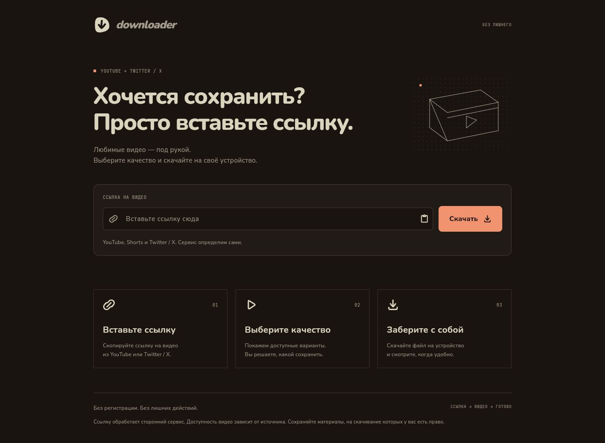
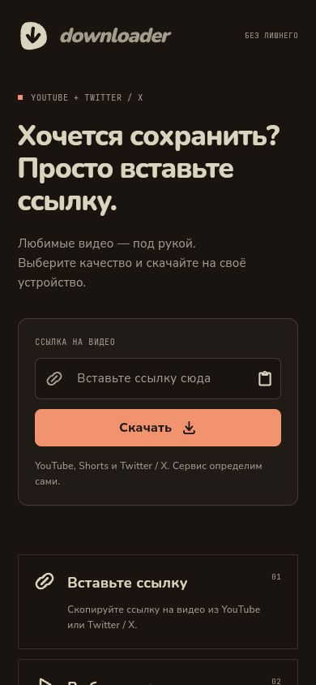

<div align="center">
  <a href="https://hecatoncheir.github.io/downloader-web/">
    
  </a>
  <h1>Downloader</h1>
  <p><strong>Ссылка → видео → готово.</strong></p>
  <p>Сохраняйте любимые видео из YouTube и Twitter / X.<br>Одно поле, выбор качества и ничего лишнего.</p>
  <p>
    <a href="https://github.com/Hecatoncheir/downloader-web/actions/workflows/pages.yml"></a>
  </p>
  <h3><a href="https://hecatoncheir.github.io/downloader-web/">Открыть приложение ↗</a></h3>
  <p>Работает в браузере · Без регистрации · Для телефона и компьютера</p>
</div>

---

## На любом экране

Один сценарий на всех устройствах. На компьютере — просторная форма и сетка вариантов качества; на телефоне — удобная кнопка и карточки в один столбец.

<table>
  <tr>
    <th>Десктопная версия</th>
    <th>Мобильная версия</th>
  </tr>
  <tr>
    <td valign="top"><a href="docs/screenshots/desktop.png"></a></td>
    <td valign="top"><a href="docs/screenshots/mobile.png"></a></td>
  </tr>
</table>

Нажмите на скриншот, чтобы открыть его в полном размере. Снимки сделаны при ширине экрана 1366 и 390 пикселей.

## Что умеет

- **Определяет сервис по ссылке.** YouTube, Shorts и Twitter / X — без ручного переключения.
- **Показывает доступное качество.** Разрешение и примерный размер файла, когда источник отдаёт нужные данные.
- **Сохраняет на устройство.** С возможностью отменить загрузку или открыть файл напрямую.
- **Остаётся простым.** Адаптивная компоновка, мягкие анимации и локально подключённые шрифты.

[История изменений](CHANGELOG.md)

## Как пользоваться

1. Вставьте ссылку в единственное поле через Ctrl+V, системное меню или кнопку «Вставить»: сервис определяется автоматически.
2. Нажмите «Скачать» — появятся доступные варианты качества.
3. Выберите вариант. «Скачать» подготовит ссылку с заголовком `Content-Disposition: attachment` и передаст файл в загрузки браузера.
4. «Открыть напрямую» — отдельное действие для просмотра исходной ссылки, а не замена скачиванию.

Качество и разрешение берутся из реальных ответов API и имён файлов. Для YouTube проверяются 360p, 720p и 1080p; одинаковые результаты объединяются. Это не полный каталог всех форматов YouTube. Для Twitter показывается исходное (лучшее доступное) качество каждого видео: Cobalt не выбирает меньший битрейт для этого сервиса. Если известны длительность и битрейт, размер рассчитывается приблизительно и отмечается знаком ≈. Неизвестный размер не подменяется выдуманным.

Наличие ссылки не гарантирует доступность файла, звук или воспроизведение. Возможности зависят от сети, платформы и API. Защищённые видео, объединение потоков Cobalt `local-processing` и авторизация не поддерживаются. Основной путь скачивания не хранит файл в памяти вкладки: передачей и прогрессом управляет браузер. Состояние «Скачивание передано браузеру» не означает, что файл уже получен целиком. Запасной путь получения файлов в память ограничен 200 МиБ и 120 секундами.

Под формой показаны понятные сообщения об ошибках. Технические подробности скрыты. Для диагностики сети используйте Console и Network браузера.

## Интерфейс

- Тёплая тёмная палитра, кремовый текст, коралловый акцент.
- Nunito — заголовки и логотип; Nunito Sans — интерфейс; JetBrains Mono — небольшие служебные метки.
- Шрифты включены локально в `assets/fonts`, лицензии OFL расположены рядом.
- Логотип и пиктограммы: `assets/brand/*.svg`; отрисовка Flutter — `lib/brand.dart`.
- Иконки PWA и вкладки генерирует `python tool/generate_brand_icons.py` (нужен Pillow).
- Один столбец на телефоне, поле и кнопка в строку и сетка качества на широком экране. Плавное раскрытие результата учитывает системное отключение анимаций.
- Состояние: `LinkInputCubit` — ссылка и определение сервиса; `ProbeCubit` — запросы, форматы, отмена и загрузка. Форма не выбирает API вручную.

## API

YouTube: `https://rue-cobalt.xenon.zone/` (Cobalt).
Twitter/X: `https://api.fxtwitter.com/` (FxEmbed) для сведений о видео и прямого просмотра; Cobalt с `alwaysProxy: true` для подготовки скачивания через `/tunnel`.

Ссылка передаётся соответствующему внешнему сервису. Доступность не гарантируется. Открытость API не означает разрешения на массовую эксплуатацию; условия следует согласовывать с владельцем экземпляра.

## Разработка

```powershell
flutter pub get
flutter run -d chrome --web-port 18764
flutter analyze
flutter test
flutter build web --release --no-web-resources-cdn --base-href /downloader-web/
```

Для локального просмотра сборки используйте `--base-href /`, затем:

```powershell
python -m http.server 18765 --bind 127.0.0.1 --directory build/web
```

GitHub Actions проверяет код и публикует `build/web` при изменении `main` или ручном запуске. Версия Flutter закреплена в `.github/workflows/pages.yml`. Успешные тесты и сборка не подтверждают доступность сторонних видеосервисов.


## Автоматическая публикация версий

GitHub Actions запускает анализатор, тесты и Web-сборку:

- В pull request к `main` — только проверка, без публикации.
- При отправке изменений в `main` — проверка и обновление GitHub Pages.
- При отправке тега `v*` — проверка соответствия тега версии в `pubspec.yaml`, сборка и публикация этой версии.
- Вручную через Actions → «Проверка и публикация Flutter Web» → Run workflow.

Для выпуска следующей версии измените `version` в `pubspec.yaml`, например на `1.0.1+2`, затем выполните:

```powershell
git add pubspec.yaml
git commit -m "Выпустить версию 1.0.1"
git push origin main
git tag -a v1.0.1 -m "Версия 1.0.1"
git push origin v1.0.1
```

Тег должен совпадать с основной версией, без номера сборки после `+`. Несовпадение останавливает публикацию. Источник GitHub Pages — GitHub Actions. Точная версия, commit и ветка или тег опубликованной сборки доступны по адресу `https://hecatoncheir.github.io/downloader-web/deployment.json`.

